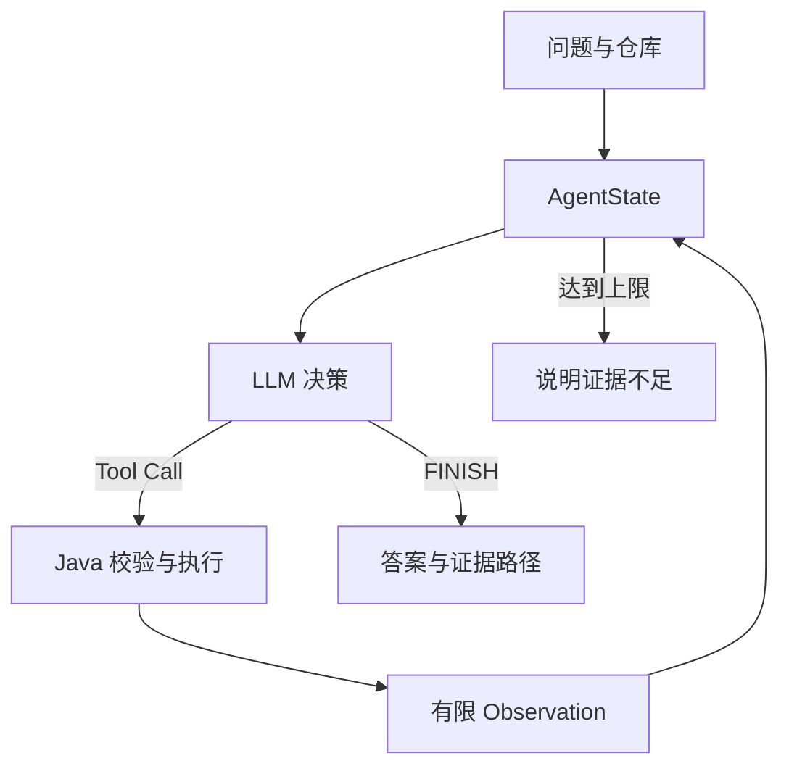

# Repository Understanding Agent

一个只读公开 GitHub 仓库的小型 Java Agent。输入仓库 URL 和问题，模型逐轮选择读取哪个文件，输出带路径依据的回答和执行 Trace。用于练习 Agent Loop、Tool Calling、Observation、State 与工程边界；它与 JobRadar 的业务后端方向互补。

## 为什么是 Agent

流程由模型按问题和上一步 Observation 决定；Java 只负责约束、执行和停止。代码没有固定的 README → Tree → Search → Read 顺序。模型不调用 Tool 而返回答案时主动 FINISH。`src/test/java/dev/repoagent/AgentLoopTest.java` 验证两种不同路径和 Observation 对下一步的影响。



## 架构

`AgentApi → AgentLoop → DecisionModel/SpringAiDecisionModel`。每个请求创建 `GitHubTools`（绑定一个 owner/repo）并注册 5 个只读 ToolCallback；`AgentState` 保存问题、step、已调用工具、已读文件、最近观察和短证据；`Trace` 由 loop 直接记录，避免引入独立复杂状态框架。

| Tool | 作用与限制 |
|---|---|
| `getFileTree(depth)` | 深度 1–4，最多 100 项 |
| `listFiles(path)` | 目录直接子项，最多 100 项 |
| `readFile(path)` | 路径必须在 GitHub tree 内；超过 100 KB 拒绝；文本最多 6000 字符 |
| `searchCode(keyword)` | 在最多 12 个候选代码文件中做字面搜索，最多 8 条命中；结果明确标记为部分搜索 |
| `getReadme()` | 根目录 README，最多 6000 字符 |

只接受 `https://github.com/owner/repo`；路径拒绝 `..`、绝对路径、反斜杠及百分号编码。仓库文件是非可信内容，提示词要求忽略其中的指令。API 错误、文件缺失和无匹配会作为 Observation 或明确异常处理；重试和上限详见 [调研与取舍](docs/DESIGN_RESEARCH.md)。第一版不提供 Shell、代码修改、MCP、RAG、数据库或前端。

## 运行

需要 Java 21、Maven 3.9+、一个兼容 OpenAI Chat Completions 的模型 Key；访问 GitHub API。不要把 Key 写进代码或提交到仓库。

```bash
export OPENAI_API_KEY='你的密钥'
export LLM_BASE_URL='https://api.openai.com'
export LLM_MODEL='gpt-4o-mini'
# 可选：提升 GitHub API 额度
export GITHUB_TOKEN='你的 token'
mvn test
mvn spring-boot:run
```

```bash
curl -s http://localhost:8080/api/agent/analyze \
  -H 'Content-Type: application/json' \
  -d '{"repoUrl":"https://github.com/spring-projects/spring-petclinic","question":"OwnerController 到数据库的数据链路是什么？"}'
```

Response 包含 `answer`、`steps`、`toolCalls`、`retries`、`stopReason` 和逐步 `trace`。本版使用 curl 或 Postman 演示；未额外接 Swagger。

## 测试和真实 Demo 的边界

- `mvn test`：10 个确定性测试，验证原生工具回调之外的 Agent Loop、不同路径、Observation、主动 FINISH、重复调用、maxSteps、一次 LLM 重试、LLM 失败、非法路径、URL 校验和输出截断。
- 设置 `LIVE_GITHUB_TESTS=true` 后，在 4 个公开仓库运行**真实 GitHub 工具 + 脚本化 Mock 决策**：`spring-guides/gs-rest-service`、`black-jing/JobRadar`、`spring-projects/spring-petclinic`、`langchain4j/langchain4j-examples`。有 [4 条完整 Trace JSON](docs/scripted-live-github-traces.json) 和 [易读版](docs/TRACE_REPORT.md)。首次网络验证 4/4 路径读到了预期文件；后续复测遇到匿名 API 403 额度上限。
- 尚无真实 LLM Key，**没有真实模型自主选路或回答质量的测试数据**。接入 Key 后，应按这 4 种问题再加入不存在功能问题，逐条审查事实、路径和停止时机；才可计算简历里的成功率与平均耗时。

## 学习与面试

[核心代码学习](docs/CORE_CODE.md) · [面试问答与 STAR](docs/INTERVIEW_STAR.md) · [参考项目设计借鉴表](docs/DESIGN_RESEARCH.md)
